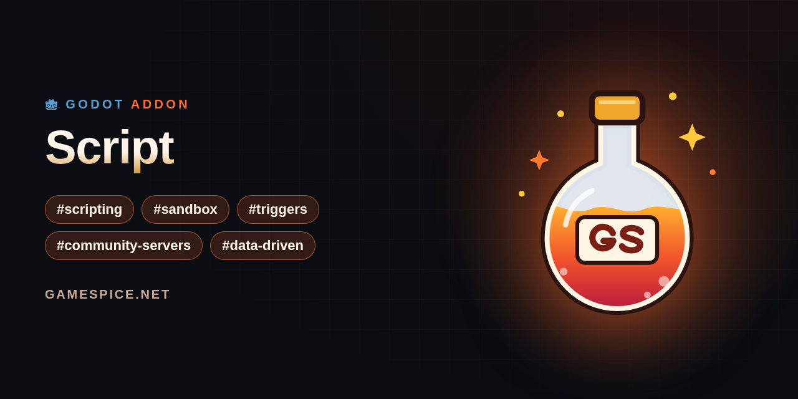

[](https://moddingcommunity.com/a/144-gs-script)

Sandboxed, data-driven scripting for community servers, for Godot 4.7+. A script is a document: rules that say *when this event happens, and these conditions hold, run these whitelisted actions*. Every action has a cost, a tick spends at most a budget, and nothing in a document can run code. Part of the [GameSpice](https://github.com/gamespice-platform) family. It needs only [GameSpice Core](https://github.com/gamespice-platform/core).

A community server wants its players to script a map or a mode without handing them a way to hang or exploit the server. So a script here is data the server validates in full before it loads, and the only things it can do are the actions the game has registered.

## Install

1. Copy `addons/gs_script/` and `addons/gs_core/` into your project.
2. Enable GameSpice Script in *Project > Project Settings > Plugins*.

## Quick start

```gdscript
var run := GSScriptRunner.new()
run.config = cfg                                   # a GSScriptConfig
run.actions.register("open_door", {"door": "string"}, 2,
        func(a: Dictionary, ctx: Dictionary) -> void: world.open(a["door"]))   # the game's own whitelist
run.message.connect(func(text: String, rule: String) -> void: hud.say(text))
run.refused.connect(func(event: String, why: String) -> void: push_warning(why))

var r := run.load_document({"version": 1, "rules": [
    {"id": "pick", "on": "pickup", "do": [{"action": "add_var", "name": "keys", "amount": 1}]},
    {"id": "open", "on": "use", "when": [{"var": "keys", "op": ">=", "value": 2}],
     "do": [{"action": "open_door", "door": "vault"}], "once": true},
]})
if not r.ok:
    push_error(r.error.message)                    # every problem is listed, nothing half-loads

run.fire("use")                                    # from the game's own events
run.tick()                                         # in _physics_process: runs what the budget allows
```

## What a document can say

- **Conditions.** `when` is a list of `{var, op, value}`; all must hold. `ctx.<key>` reads the event's context (who fired it) instead of a variable. Operators are `== != < <= > >=`.
- **Cooldowns and once.** `cooldown` (seconds, counted down by `advance(dt)`) and `once` keep a rule quiet.
- **Actions.** `message`, `set_var`, `add_var`, `toggle_var`, `enable_rule`, `disable_rule`, `emit`, plus whatever the game registers.
- **Saves.** `snapshot()` and `restore()` carry variables, which rules are on and running cooldowns.
- **Text.** `load_text()` parses JSON with a size limit; `GSScriptCodec.stringify()` writes it back. Text that looks like code is only ever text.

See [docs/format.md](docs/format.md) for the full format and `examples/script_demo.gd` for a runnable walk-through.

## Settings

Every number is a field on `GSScriptConfig`. The values below are defaults, and the ranges are inspector slider limits, not enforced caps. Set the property from code or a config file to go beyond them; 0 means unlimited where it says so.

| Setting | Default | What it does |
| --- | --- | --- |
| `enabled` | true | Turns scripting on or off. Off, no event runs. |
| `max_rules` | 256 | Most rules in one document. 0 is unlimited. |
| `max_actions_per_rule` | 16 | Most actions in one rule. 0 is unlimited. |
| `max_document_bytes` | 262144 | Largest JSON text `load_text()` accepts. 0 is unlimited. |
| `max_text_length` | 200 | Longest text an action may carry. 0 is unlimited. |
| `tick_budget` | 200 | Cost one `tick()` may spend; the rest waits for the next tick. 0 is unlimited. |
| `max_queued_events` | 1024 | Events that may wait. Past it, `fire()` returns false. 0 is unlimited. |
| `max_vars` | 4096 | Most variables a script may create; past it the action is refused. 0 is unlimited. |
| `allowed_actions` | empty | If set, only these action ids may be used; empty allows every registered action. |

Layers, weakest first: the defaults, `cfg/addon/gs_script/*.yml`, the game's files, the operator's files, `GS_SCRIPT_*` environment variables, then `--script-*` flags. A game that wants cvars binds the config with GameSpice Game's `GSGameConfigBinder` (`profile_kind = "script"`).

## What it is not

**Not a general scripting language.** There is no expression evaluator, no `eval`, no loops and no way to name a method. A document that needs more is a sign the game should register a new action.

**Not the converter's script replay.** GameSpice Map keeps the Source `lua_run` calls a converted map carries and replays a few known ones through its own whitelist (`GSMapScript`). This addon is a document format a server's community writes.

**Not map entity I/O.** Relays, counters, timers and triggers wired by name belong to GameSpice Logic (generic) and GameSpice Map (Source entities).

**Not a mod loader.** It never loads a script file as code. Content delivery and publishing are GameSpice Cloud's.

## Test

```bash
godot --headless --path . --import
godot --headless --path . res://examples/script_selftest.tscn
```

The self-test is offline and exits non-zero on any failure (68 checks plus the two summary checks).

## Status

Built and maintained with Claude Code. The test suites pass, but little of this has been in front of real players yet. Please report rough edges by opening an issue.

## Licence

MIT. See [LICENSE](LICENSE). Only the TMC back-end web infrastructure is not open source.
